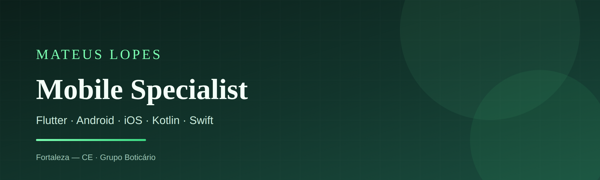

  

<h1 align="center">Mateus Lopes</h1>

  <strong>Developer Specialist I</strong> 
  Software Engineer · Multiplataforma 
  Flutter · React Native · TypeScript · Android · iOS 
  <em>Grupo Boticário · Fortaleza, CE</em>

  
  
  
  

---

### Sobre

Engenheiro de software focado em produtos **multiplataforma** — do nativo (**Android** / **iOS**) ao ecossistema **Flutter**, **React Native**, **JavaScript** e **TypeScript**.

Trabalho com arquitetura, experiência do usuário e qualidade de código. Também uso **Kotlin**, **Swift**, **Kotlin Multiplatform** e fundamentos de **Go**.

---

### Stack

| Área | Tecnologias |
| --- | --- |
| **Linguagens** | TypeScript, JavaScript, Dart, Kotlin, Swift, Go |
| **Multiplataforma** | Flutter, React Native, Kotlin Multiplatform (KMM) |
| **Mobile nativo** | Android, iOS |
| **Estado & arquitetura** | GetX, Provider, RxDart, MVC / MVVM |
| **Backend & dados** | Firebase (Auth, Firestore, Storage, Analytics), Dio, REST, sqflite |
| **Ferramentas** | Xcode, Android Studio, VS Code, Git |
| **Outros** | Ionic |

  
  
  
  
  
  
  
  
  
  
  

---

### Escrita

Artigos no [Medium](https://medium.com/@mateusdevelopes):

- [Understanding the Null Check Operator in Flutter](https://medium.com/@mateusdevelopes/understanding-the-null-check-operator-in-flutter-straight-to-the-point-e651068c30a5)
- [Mastering SOLID Principles in Flutter and Dart](https://medium.com/@mateusdevelopes/mastering-solid-principles-in-flutter-and-dart-53c3217c3648)

---

### GitHub

  
  

---

  Fortaleza — CE · aberto a conversas sobre engenharia de software, multiplataforma e arquitetura 
  <a href="mailto:mateusdevelopes@gmail.com">mateusdevelopes@gmail.com</a>

